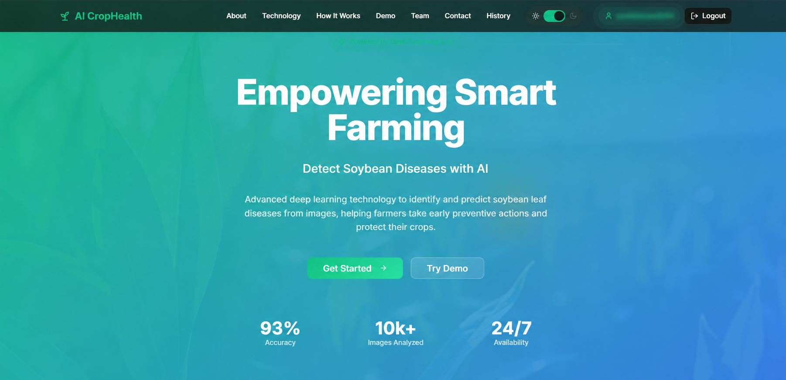
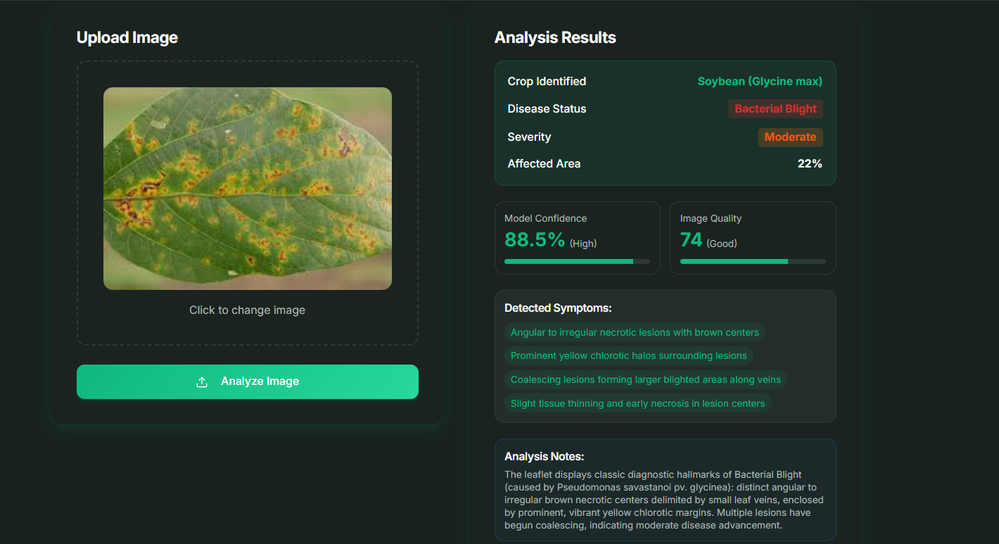
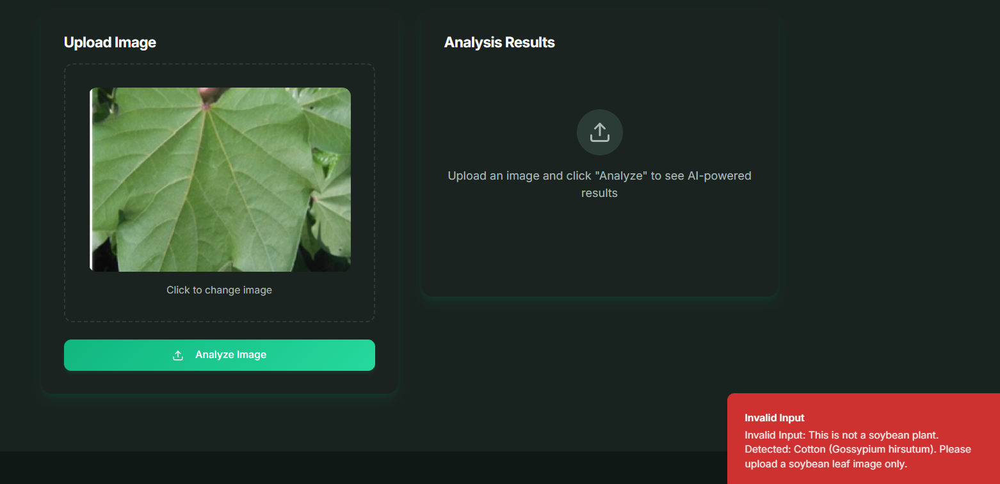

# 🌱 AI-Driven Soybean Crop Disease Prediction and Management System

An AI-powered web application for detecting soybean crop diseases through leaf image analysis and providing disease information, treatment recommendations, and preventive measures.

## 📌 Project Overview

The **AI-Driven Soybean Crop Disease Prediction and Management System** is a web-based application developed to help identify soybean crop diseases using Artificial Intelligence and Deep Learning.

Users can upload soybean leaf images for analysis. The system validates the uploaded image, identifies whether it belongs to a soybean plant, and predicts its possible disease condition. It also provides disease-related information, symptoms, treatment recommendations, and preventive measures.

The application is specifically designed for soybean plants and rejects unsupported plant images.

## 🎯 Objectives

- Detect soybean leaf diseases through image analysis.
- Apply Deep Learning techniques for disease classification.
- Identify healthy and diseased soybean leaves.
- Provide disease information and detected symptoms.
- Suggest treatment and preventive measures.
- Develop a simple and user-friendly web application.

## ✨ Key Features

- **AI-Based Disease Detection:** Analyze uploaded soybean leaf images.
- **Healthy Leaf Identification:** Identify healthy soybean leaves.
- **Disease Classification:** Display the predicted disease condition.
- **Disease Analysis:** Present prediction results and supported analysis details.
- **Plant Validation:** Reject images that do not belong to soybean plants.
- **Treatment Recommendations:** Provide disease management suggestions.
- **Prevention Measures:** Display preventive guidance.
- **User Dashboard:** View analysis history and statistics.
- **Authentication:** User login and logout functionality.
- **Responsive Interface:** User-friendly application design.
- **Dark and Light Modes:** Support different interface themes.

## 🖥️ Application Screenshots

### Homepage


### Disease Prediction


### Dashboard


### Healthy Soybean Leaf


### Invalid Image Detection


### Treatment and Prevention


## ⚙️ System Workflow

1. User opens the web application.
2. User logs in to access the application.
3. User uploads a soybean leaf image.
4. The system validates the uploaded image.
5. The image is processed by the disease prediction functionality.
6. The system displays the prediction and analysis results.
7. Disease-related information, treatment recommendations, and preventive measures are presented.
8. Users can view their previous analyses through the dashboard and history.

**Workflow:**

`Login → Image Upload → Plant Validation → Image Analysis → Disease Prediction → Results → Recommendations`

## 🛠️ Technologies Used

| Category | Technologies |
|---|---|
| Frontend | React.js, TypeScript |
| Styling | Tailwind CSS |
| Build Tool | Vite |
| UI Components | shadcn/ui |
| Backend | Supabase |
| Database | Supabase Database |
| Backend Functions | Supabase Edge Functions |
| AI / Deep Learning | CNN-based image classification |
| Version Control | Git, GitHub |

## 📂 Project Structure

```text
AI-Driven-Soybean-Crop-Disease-Prediction/
│
├── screenshots/
│   ├── Homepage.png
│   ├── Bacterial Blight prediction.png
│   ├── Dashboard.png
│   ├── Healthy soybean leaf prediction.png
│   ├── Invalid plant image detection.png
│   └── Treatment and prevention recommendations.png
│
├── src/
│   ├── assets/
│   ├── components/
│   │   ├── ui/
│   │   └── ...
│   ├── hooks/
│   ├── integrations/
│   │   └── supabase/
│   ├── lib/
│   ├── pages/
│   ├── App.tsx
│   ├── App.css
│   ├── index.css
│   └── main.tsx
│
├── supabase/
│   ├── functions/
│   │   └── analyze-plant/
│   ├── migrations/
│   └── config.toml
│
├── .gitignore
├── package.json
├── package-lock.json
├── index.html
├── vite.config.ts
└── README.md
```

## 🚀 Installation and Setup

### Prerequisites

- Node.js
- npm
- Git
- Supabase project credentials

### 1. Clone the Repository

```bash
git clone https://github.com/Yashika-mandle/AI-Driven-SoyaBeans-Crop-Disease-Prediction.git
```

### 2. Navigate to the Project Directory

```bash
cd AI-Driven-SoyaBeans-Crop-Disease-Prediction
```

### 3. Install Dependencies

```bash
npm install
```

### 4. Configure Environment Variables

Create a `.env` file in the root directory and add your Supabase configuration.

```env
VITE_SUPABASE_PROJECT_ID=your-project-id
VITE_SUPABASE_URL=your-supabase-url
VITE_SUPABASE_PUBLISHABLE_KEY=your-publishable-key
```

**Important:** Never upload `.env` files, service-role keys, or other secret credentials to GitHub.

### 5. Start the Development Server

```bash
npm run dev
```

Open the localhost URL displayed in your terminal to access the application.

## 🗄️ Backend Configuration

The application uses Supabase for backend integration.

The `supabase/` directory contains:

- Edge Functions for backend operations.
- Database migration files.
- Supabase configuration.

Configure your Supabase project and deploy the required functions and migrations before using backend-dependent features.

## 🔮 Future Enhancements

- Improve disease prediction accuracy using larger and more diverse datasets.
- Support additional soybean disease categories.
- Add multilingual support for farmers.
- Integrate weather information for better crop management.
- Improve disease severity estimation.
- Develop a mobile application.
- Provide more detailed crop management recommendations.

## 🎓 Project Information

| Detail | Description |
|---|---|
| Project Title | AI-Driven Soybean Crop Disease Prediction and Management System |
| Project Domain | Artificial Intelligence and Deep Learning |
| Application Type | Web-Based Application |
| Primary Crop | Soybean |
| Project Purpose | Academic Project |


## 📜 License

This project is developed for academic and educational purposes.