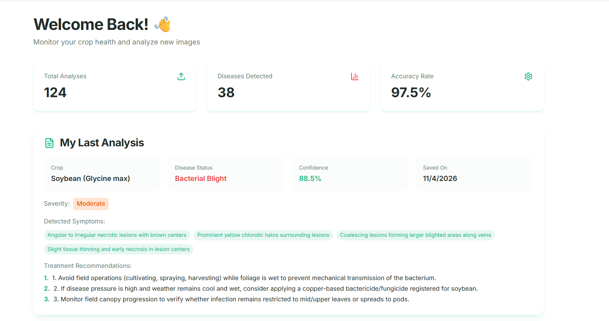
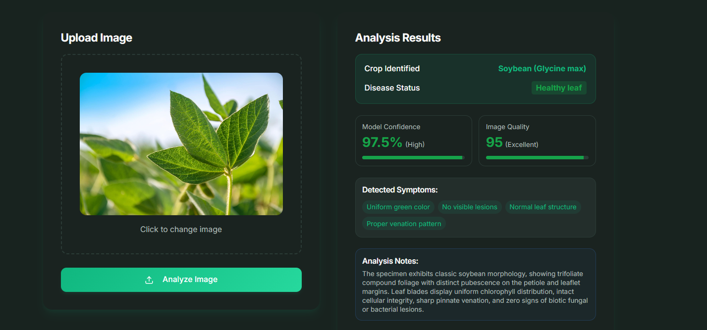
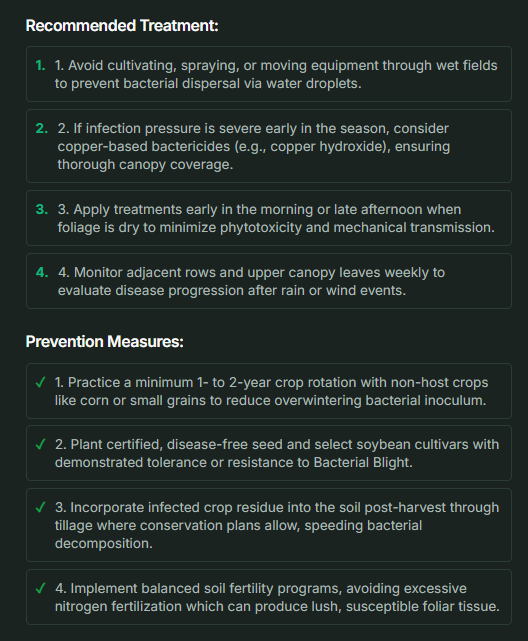

# 🌱 AI-Driven Soybean Crop Disease Prediction and Management System

An AI-powered web application designed to identify soybean leaf diseases from images and provide disease analysis, treatment recommendations, and preventive measures.

## 📌 Project Overview

The **AI-Driven Soybean Crop Disease Prediction and Management System** aims to help users identify soybean crop diseases using Artificial Intelligence and Deep Learning.

The application allows users to upload soybean leaf images for disease analysis. It identifies the soybean plant, predicts its possible disease condition, displays detected symptoms, and provides treatment and prevention recommendations.

The system is specifically designed for soybean plants and rejects images of unsupported plants.

## 🎯 Objectives

- Detect soybean leaf diseases through image analysis.
- Apply Deep Learning techniques for disease classification.
- Identify healthy and diseased soybean leaves.
- Provide disease information and detected symptoms.
- Suggest treatment and preventive measures.
- Develop a simple and user-friendly web application.

## ✨ Key Features

- **AI-Based Disease Detection:** Analyze uploaded soybean leaf images.
- **Healthy Leaf Identification:** Identify healthy soybean leaves.
- **Disease Classification:** Display the predicted disease status.
- **Disease Analysis:** Show severity, confidence, image quality, and detected symptoms where supported.
- **Plant Validation:** Reject images that do not belong to soybean plants.
- **Treatment Recommendations:** Display suggested disease management measures.
- **Prevention Measures:** Provide preventive guidance.
- **User Dashboard:** View analysis history and statistics.
- **Authentication:** User login and logout functionality.
- **Responsive Interface:** User-friendly application design.
- **Dark and Light Modes:** Support different interface themes.

## 🖥️ Application Screenshots

### 1. Homepage

The landing page introduces the application and its soybean disease detection capabilities.


### 2. Soybean Disease Detection

Upload a soybean leaf image and analyze it to obtain disease prediction results.


### 3. User Dashboard

View analysis statistics, previous predictions, disease status, and management recommendations.



### 4. Healthy Soybean Leaf Detection

The system identifies a healthy soybean leaf and displays its analysis results.



### 5. Invalid Plant Image Detection

The system validates uploaded images and rejects unsupported plants, such as cotton.


### 6. Treatment and Prevention Recommendations

Displays recommended treatment methods and preventive measures for soybean diseases.



## ⚙️ System Workflow

1. User opens the web application.
2. User logs in to access the application.
3. User uploads a soybean leaf image.
4. The system validates the uploaded image.
5. The image is analyzed by the disease prediction functionality.
6. The system displays the prediction and analysis results.
7. Disease-related symptoms, treatment recommendations, and preventive measures are presented.
8. Analysis information can be viewed through the dashboard and history.

**Workflow:**

`Login → Upload Image → Plant Validation → Image Analysis → Disease Prediction → Results → Recommendations`

## 🛠️ Technologies Used

| Category | Technologies |
|---|---|
| Frontend | React.js, TypeScript |
| Styling | Tailwind CSS |
| Build Tool | Vite |
| UI Components | shadcn/ui |
| Backend | Supabase |
| Database | Supabase Database |
| Backend Functions | Supabase Edge Functions |
| AI / Deep Learning | CNN-based image classification |
| Version Control | Git, GitHub |

## 📂 Project Structure

```text
AI-Driven-Soybean-Crop-Disease-Prediction/
│
├── screenshots/
│   ├── homepage.png
│   ├── disease-detection.png
│   ├── dashboard.png
│   ├── healthy-leaf.png
│   ├── invalid-input.png
│   └── treatment-recommendations.png
│
├── src/
│   ├── assets/
│   ├── components/
│   │   ├── ui/
│   │   ├── About.tsx
│   │   ├── Contact.tsx
│   │   ├── Dashboard.tsx
│   │   ├── Demo.tsx
│   │   ├── Hero.tsx
│   │   └── ...
│   │
│   ├── hooks/
│   ├── integrations/
│   │   └── supabase/
│   ├── lib/
│   ├── pages/
│   ├── App.tsx
│   ├── App.css
│   ├── index.css
│   └── main.tsx
│
├── supabase/
│   ├── functions/
│   │   └── analyze-plant/
│   ├── migrations/
│   └── config.toml
│
├── .gitignore
├── package.json
├── package-lock.json
├── index.html
├── vite.config.ts
└── README.md
```

## 🚀 Installation and Setup

### Prerequisites

- Node.js
- npm
- Git
- Supabase project credentials

### 1. Clone the Repository

```bash
git clone https://github.com/YOUR-USERNAME/AI-Driven-Soybean-Crop-Disease-Prediction.git
```

### 2. Navigate to the Project Directory

```bash
cd AI-Driven-Soybean-Crop-Disease-Prediction
```

### 3. Install Dependencies

```bash
npm install
```

### 4. Configure Environment Variables

Create a `.env` file in the project root directory.

Add your Supabase configuration:

```env
VITE_SUPABASE_PROJECT_ID=your-project-id
VITE_SUPABASE_URL=your-supabase-url
VITE_SUPABASE_PUBLISHABLE_KEY=your-publishable-key
```

**Important:** Never upload `.env` files, service-role keys, or other secret credentials to GitHub.

### 5. Start the Development Server

```bash
npm run dev
```

Open the localhost URL displayed in your terminal.

## 🗄️ Backend Configuration

The project uses Supabase for backend integration.

The `supabase/` directory includes:

- Edge Functions for backend operations.
- Database migration files.
- Supabase configuration.

Configure the Supabase project and deploy the required functions and migrations before using backend-dependent features.

## 🔮 Future Enhancements

- Improve disease prediction accuracy with larger datasets.
- Support additional soybean disease categories.
- Add multilingual support for farmers.
- Integrate weather information for better crop management.
- Improve disease severity estimation.
- Develop a mobile application.
- Provide more detailed and personalized crop management recommendations.

## 🎓 Project Information

| Detail | Description |
|---|---|
| Project Title | AI-Driven Soybean Crop Disease Prediction and Management System |
| Domain | Artificial Intelligence and Deep Learning |
| Application Type | Web-Based Application |
| Primary Crop | Soybean |
| Project Purpose | Academic Project |

## 📜 License

This project is developed for academic and educational purposes.
